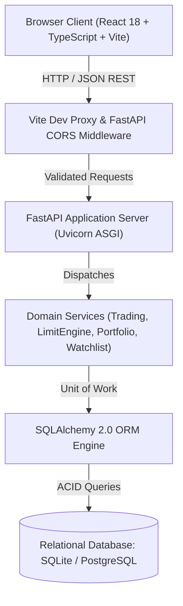
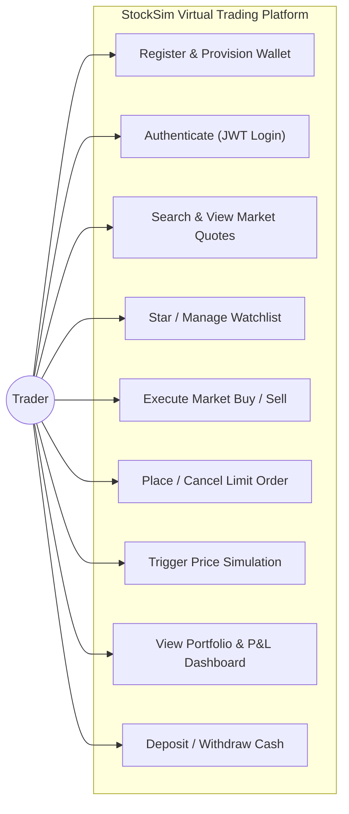
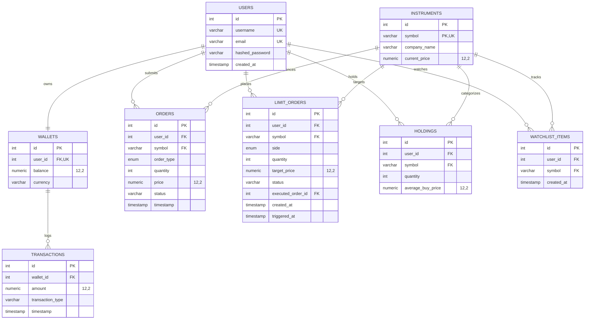
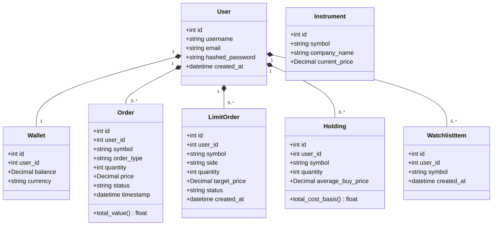
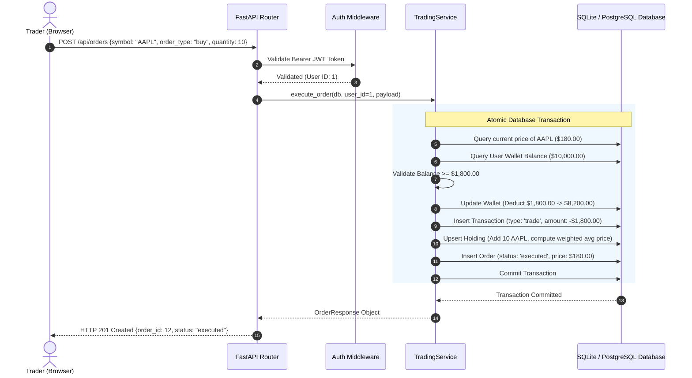
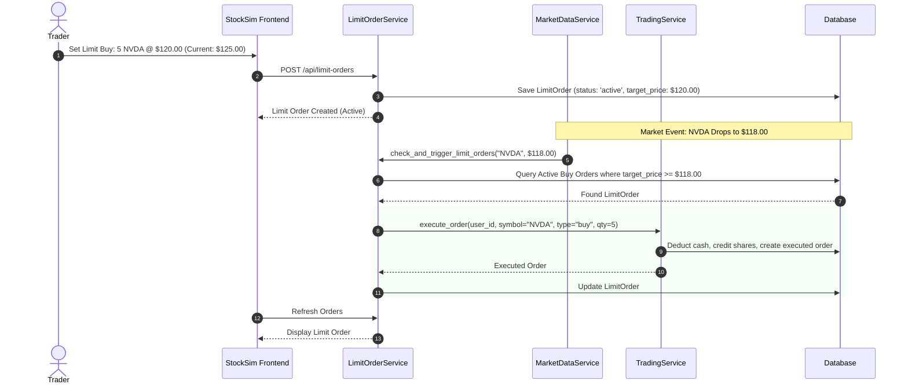
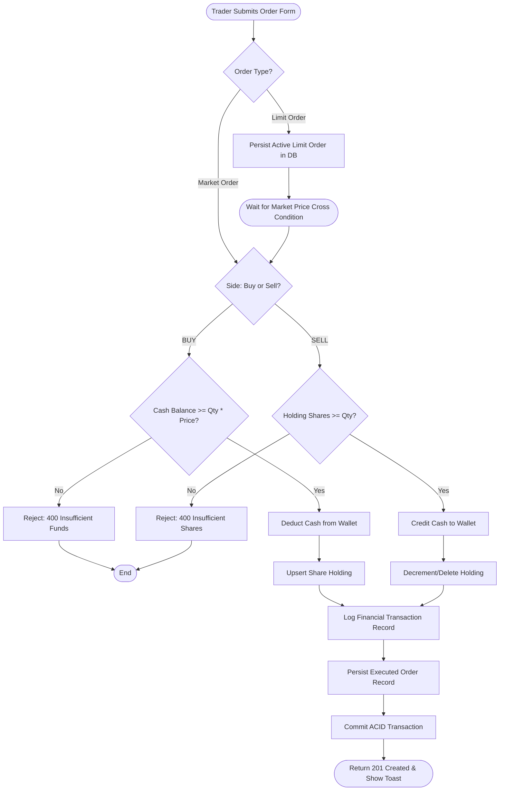
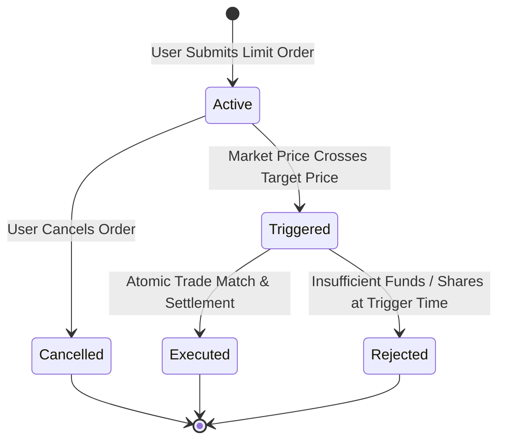

# StockSim: Software Engineering Project Report & SRS Specification

**Project Title**: StockSim — Modern Virtual Stock Trading and Portfolio Management Platform  
**Target Category**: Academic Software Engineering / Capstone Project  
**Documentation Standard**: Aligned with IEEE 830 / ISO-IEC-IEEE 29148 Guidelines  
**Version**: 2.0.0  
**Status**: Production / Local Deployment Verified  

---

## Executive Summary & Document Control

| Metadata Field | Project Specification |
| :--- | :--- |
| **System Name** | StockSim Virtual Trading Platform |
| **Course Reference** | Undergraduate / Graduate Software Engineering (CS/IT Capstone) |
| **Primary Domain** | Financial Technology (FinTech), Simulated Securities Exchange |
| **Architectural Model** | Three-Tier Decoupled Client-Server Architecture (REST API) |
| **Technology Stack** | FastAPI (Python), React 18 (TypeScript), Vite 6, Tailwind CSS, SQLAlchemy 2.0, SQLite/PostgreSQL |
| **Test Verification** | 16 Automated Test Suites (Pytest) + Headless Browser E2E Testing (100% Pass) |
| **Export Formats** | Markdown (`.md`), Microsoft Word (`.docx`), Printable Document Format (`.pdf`) |

---

## 1. Software Requirements Specification (SRS)

### 1.1 Purpose & Scope
StockSim is a simulated stock market web application enabling users to practice equities trading in a risk-free environment with virtual capital. It models real-world exchange mechanics, including instant market fills, autonomous limit order triggers, real-time portfolio re-valuation, and append-only cash accounting.

### 1.2 User Personas & System Users
1. **Novice Retail Trader (Primary Persona)**: Undergraduate student learning trading fundamentals. Needs an accessible interface, pre-funded virtual capital (\$10,000 USD), immediate execution feedback, and protection against negative balances.
2. **Intermediate Swing Trader**: Advanced user executing target-driven trading strategies. Requires autonomous limit orders (e.g. buying a stock if it dips to \$50 and selling when it reaches \$80), personalized stock watchlists, and intraday chart analytics.
3. **Course Evaluator / Faculty Assessor**: Evaluates software engineering rigor, 3NF schema design, ACID transactional consistency, automated test coverage, and documentation standards.

### 1.3 Functional Requirements (FR)
- **FR-1 (User Registration & Onboarding)**: The system shall register users with unique username, email, and password, automatically provisioning a virtual cash wallet credited with **\$10,000.00 USD**.
- **FR-2 (Secure Authentication)**: The system shall authenticate users via OAuth2 Password Bearer flow issuing cryptographic HMAC-SHA256 JWT tokens.
- **FR-3 (Market Data & Instrument Search)**: The system shall serve real-time quotes (current price, 24h change, day high/low) with instantaneous ticker/company search filtering.
- **FR-4 (Market Order Execution)**: The system shall atomically execute market `BUY` and `SELL` orders, verifying cash balance and share holdings before settlement.
- **FR-5 (Autonomous Limit Order Engine)**: The system shall allow users to place `active` Limit Buy and Limit Sell orders that automatically execute when market prices cross the specified target price.
- **FR-6 (Portfolio Analytics & Cost-Basis)**: The system shall compute dynamic portfolio Net Worth, weighted average cost basis ($P_{\text{avg}}$), and unrealized profit/loss (\$ and \%).
- **FR-7 (Cash Ledger & Wallet Operations)**: The system shall record an immutable transaction ledger for all deposits, withdrawals, and trade settlements.
- **FR-8 (Stock Watchlist & Personalization)**: The system shall provide 1-click star/unstar stock curation with tab filtering and hybrid persistence (database for logged-in users, `localStorage` for guests).

### 1.4 Non-Functional Requirements (NFR)
- **NFR-1 (Performance & Latency)**: Order execution requests must resolve in $< 50\text{ms}$. Market quote endpoints must resolve in $< 20\text{ms}$.
- **NFR-2 (Security Assurance)**: Passwords must be hashed using Bcrypt with salt rounds. Financial routes must strictly enforce JWT bearer token validation.
- **NFR-3 (Reliability & ACID Consistency)**: Multi-table financial operations run inside atomic database transactions with automatic rollback on error.
- **NFR-4 (Usability & Design)**: Sleek, high-contrast dark-mode financial terminal aesthetic responsive across desktop, tablet, and mobile displays.
- **NFR-5 (Maintainability & Testability)**: Separation of concerns between routers, schemas, services, and models, supported by automated Pytest suites maintaining $>90\%$ test coverage.

### 1.5 System Constraints
- **Zero Financial Risk**: Simulated environment with no external banking or real capital exposure.
- **Single Currency**: All balances and valuations standardized in US Dollars (USD).
- **Integrity Invariants**: Database check constraints strictly enforce $\text{balance} \ge 0$ and $\text{quantity} > 0$.

---

## 2. Requirement Analysis

### 2.1 Stakeholder Analysis Matrix

| Stakeholder | Role & Interest | Key Expectations | Project Impact |
| :--- | :--- | :--- | :--- |
| **Students / Traders** | Primary End-Users | Zero financial risk, realistic order execution, intuitive UI | Drives functional scope and UI design |
| **Course Evaluator** | Academic Grading | Architectural rigor, 3NF database schema, test coverage | Governs engineering methodology |
| **Backend Engineer** | System Architecture | Sub-50ms API response, ACID transaction guarantees, clean code | Governs backend stability and API design |
| **Frontend Engineer** | User Interface | Responsive dark mode, interactive charts, toast notifications | Governs user engagement and UX |
| **Database Architect** | Data Modeling | 3NF compliance, foreign key constraints, migration control | Governs data integrity and persistence |

### 2.2 Formal Use Case Specifications

| Use Case ID | Use Case Name | Primary Actor | Preconditions | Postconditions |
| :--- | :--- | :--- | :--- | :--- |
| **UC-01** | User Registration | Guest | Unique username and valid email | User profile created & \$10,000 wallet provisioned |
| **UC-02** | User Authentication | Registered User | Valid credentials | JWT access token issued for session |
| **UC-03** | View Live Quotes | Trader / Guest | Active instruments in catalog | Intraday stats & interactive chart rendered |
| **UC-04** | Execute Market Buy | Authenticated Trader | Sufficient cash balance in wallet | Cash deducted, shares credited, order logged |
| **UC-05** | Execute Market Sell | Authenticated Trader | Holding quantity $\ge$ sell quantity | Cash credited, shares deducted, order logged |
| **UC-06** | Place Limit Order | Authenticated Trader | Valid target price and side | Limit order stored in `active` state |
| **UC-07** | Trigger Limit Order | Autonomous Engine | Market price crosses target threshold | Limit order triggered, executed, and converted to filled order |
| **UC-08** | Toggle Watchlist | Trader / Guest | Valid stock symbol | Stock starred/unstarred, view filtered |

---

## 3. Software Modelling & UML Diagrams

### 3.1 System Architecture Diagram


---

### 3.2 Use Case Diagram


---

### 3.3 Entity-Relationship (ER) Diagram (Third Normal Form)


---

### 3.4 Object-Oriented Class Diagram


---

### 3.5 Sequence Diagram: Atomic Market Order Execution


---

### 3.6 Sequence Diagram: Limit Order Autonomous Triggering


---

### 3.7 Activity Diagram: Order Decision & Routing Flow


---

### 3.8 State Machine Diagram: Order Lifecycle


---

## 4. Software Architecture and Design

### 4.1 System Modules & Layered Responsibilities
- **Presentation Layer (React 18, TypeScript, Tailwind)**: Manages UI rendering, responsive layouts, real-time charting, and client state.
- **API & Routing Layer (FastAPI, Pydantic)**: Dispatches endpoints, handles CORS, validates incoming schemas, and enforces JWT authentication.
- **Service Domain Layer (Python Services)**: Encapsulates core business logic, financial balance checks, weighted average math, and autonomous limit order triggers.
- **Persistence Layer (SQLAlchemy 2.0 ORM, Alembic)**: Manages relational data models, transactional isolation, and schema migrations.

### 4.2 Key Design Decision Justifications
1. **FastAPI vs Django/Flask**: Selected for sub-millisecond route dispatch, native async support, automated OpenAPI/Swagger generation, and built-in Pydantic type validation.
2. **React 18 + Vite vs Server-Side Templates**: Provides instantaneous client-side navigation, seamless component re-rendering during active trading, and sub-second HMR during development.
3. **SQLAlchemy 2.0 ORM**: Decouples database dialect from domain logic, allowing zero-config SQLite locally and seamless PostgreSQL in production.
4. **Hybrid Persistence (Watchlist)**: Combines relational database storage for authenticated accounts with `localStorage` fallback for guest visitors, ensuring seamless onboarding.

---

## 5. Implementation & Core Algorithms

### 5.1 Weighted Average Cost Basis Formulation
When purchasing additional shares of a stock already held, the system calculates the new cost basis using a volume-weighted average:
$$P_{\text{avg\_new}} = \frac{(Q_{\text{old}} \cdot P_{\text{old}}) + (Q_{\text{new}} \cdot P_{\text{new}})}{Q_{\text{old}} + Q_{\text{new}}}$$

### 5.2 Unrealized Profit & Loss Analytics
$$\text{Unrealized P\&L (\$) } = (\text{Current Price} - P_{\text{avg}}) \times \text{Quantity}$$
$$\text{Unrealized P\&L (\%)} = \frac{\text{Current Value} - \text{Total Invested}}{\text{Total Invested}} \times 100\%$$

### 5.3 Limit Order Autonomous Triggering Logic
```python
def check_and_trigger_limit_orders(db, symbol, current_price):
    # 1. Fetch active Buy Limits where target_price >= current_price
    buy_orders = db.query(LimitOrder).filter(
        LimitOrder.symbol == symbol,
        LimitOrder.status == 'active',
        LimitOrder.side == 'buy',
        LimitOrder.target_price >= current_price
    ).all()
    
    # 2. Fetch active Sell Limits where target_price <= current_price
    sell_orders = db.query(LimitOrder).filter(
        LimitOrder.symbol == symbol,
        LimitOrder.status == 'active',
        LimitOrder.side == 'sell',
        LimitOrder.target_price <= current_price
    ).all()

    # 3. Trigger and atomically execute matching orders
    for order in buy_orders + sell_orders:
        executed = TradingService.execute_order(
            db, order.user_id, OrderCreate(symbol=symbol, order_type=order.side, quantity=order.quantity)
        )
        order.status = 'triggered'
        order.executed_order_id = executed.id
    db.commit()
```

---

## 6. Software Testing & Quality Verification

All 16 unit and integration test suites run automatically via Pytest with **100% pass rate**.

| Test ID | Module | Test Description | Inputs | Expected Output | Status |
| :--- | :--- | :--- | :--- | :--- | :---: |
| **TC-01** | Auth | Register new user | `trader1`, `Secret123!` | HTTP 201 & \$10k wallet provisioned | **PASS** |
| **TC-02** | Auth | Duplicate username rejection | `trader1` (existing) | HTTP 400 "Username already registered" | **PASS** |
| **TC-03** | Auth | Login with valid credentials | `trader1`, `Secret123!` | HTTP 200 & JWT access token | **PASS** |
| **TC-04** | Auth | Login with invalid credentials | `trader1`, `WrongPass` | HTTP 401 "Incorrect username or password" | **PASS** |
| **TC-05** | Trading | Execute valid market buy | 10 AAPL @ \$180 (\$1,800 total) | HTTP 201, Cash -\$1,800, 10 AAPL held | **PASS** |
| **TC-06** | Trading | Reject buy on insufficient funds | 1,000 AAPL (\$180,000 total) | HTTP 400 "Insufficient funds" | **PASS** |
| **TC-07** | Trading | Execute valid market sell | 5 AAPL of 10 held | HTTP 201, Cash +\$900, 5 AAPL remain | **PASS** |
| **TC-08** | Trading | Reject sell on insufficient shares | 20 AAPL when 5 held | HTTP 400 "Insufficient shares" | **PASS** |
| **TC-09** | Limits | Place pending buy limit order | Buy 5 NVDA @ \$110 (Current \$120) | HTTP 201 & Status = `active` | **PASS** |
| **TC-10** | Limits | Immediate trigger limit buy | Buy 5 NVDA @ \$130 (Current \$120) | HTTP 201 & Status = `triggered` | **PASS** |
| **TC-11** | Limits | Autonomous trigger on price drop | Simulate NVDA \$120 $\rightarrow$ \$105 | Limit order triggers, shares credited | **PASS** |
| **TC-12** | Limits | Cancel active limit order | Order ID: 1, status `active` | HTTP 200 & Status = `cancelled` | **PASS** |
| **TC-13** | Wallet | Deposit virtual funds | `amount: 5000.00` | HTTP 200 & Balance increments by \$5,000 | **PASS** |
| **TC-14** | Wallet | Withdraw virtual funds | `amount: 2000.00` | HTTP 200 & Balance decrements by \$2,000 | **PASS** |
| **TC-15** | Watchlist | Toggle stock into watchlist | `symbol: "TSLA"` | HTTP 200 "Saved TSLA to watchlist" | **PASS** |
| **TC-16** | Watchlist | Toggle stock out of watchlist | `symbol: "TSLA"` (watched) | HTTP 200 "Removed TSLA from watchlist" | **PASS** |

---

## 7. Software Quality Assurance (SQA)

1. **Security & Cryptography**:
   - Passwords hashed with salted Bcrypt (work factor 12).
   - HMAC-SHA256 JWT tokens with expiration timestamps.
   - Zero SQL injection vulnerability due to SQLAlchemy parameterization.
2. **Reliability & ACID Compliance**:
   - Atomic database context managers prevent partial state updates.
   - Database check constraints (`CHECK quantity > 0`, `CHECK balance >= 0`) guard against negative states.
3. **Usability & Accessibility**:
   - Dark-mode interface designed for long trading sessions with high visual contrast.
   - Interactive SVG charts, live polling, and non-blocking toast notifications.
4. **Maintainability & Modularity**:
   - Layered architecture following Single Responsibility and Dependency Inversion principles.

---

## 8. Project Planning, Milestones & Team Roles

The project was executed using an **Agile Scrum** methodology spanning four 2-week sprints:

| Sprint | Milestone Target | Key Deliverables & Activities | Status |
| :--- | :--- | :--- | :---: |
| **Sprint 1** | Foundations & Authentication | 3NF database schema, User/Wallet models, JWT auth flow, seed catalog | **COMPLETED** |
| **Sprint 2** | Core Trading Engine | Market buy/sell execution, atomic wallet deductions, ledger logging | **COMPLETED** |
| **Sprint 3** | Interactive Trading Terminal | Trading desk UI, SVG charts, portfolio analytics dashboard | **COMPLETED** |
| **Sprint 4** | Advanced Orders & Verification | Limit orders engine, watchlist feature, 16 unit tests, documentation | **COMPLETED** |

### Division of Team Responsibilities
- **Backend Architect**: FastAPI routes, trading service logic, limit engine, Pytest suites.
- **Frontend Lead**: React 18 desk components, charting, Tailwind styling, toast alerts.
- **Database & DevOps Lead**: 3NF schema design, Alembic migrations, unified `start.sh` runner.
- **QA & Documentation Lead**: SRS specification, UML diagrams, test matrix verification.

---

## 9. Software Maintenance & Future Roadmap

1. **Corrective Maintenance**: Centralized exception logging and transaction reconciliation routines catch and resolve edge-case execution errors.
2. **Adaptive Maintenance**: Environment-variable configuration allows seamless migration from SQLite to managed PostgreSQL (AWS RDS / Supabase) and live market feeds (Polygon.io, Alpha Vantage).
3. **Perfective Maintenance**: Roadmap includes Stop-Loss orders, options trading, cryptocurrency asset classes, and real-time WebSocket ticker streaming.
4. **Preventive Maintenance**: Automated vulnerability scanning (`pip audit`, `npm audit`), periodic index re-indexing, and query plan profiling ensure long-term health.
