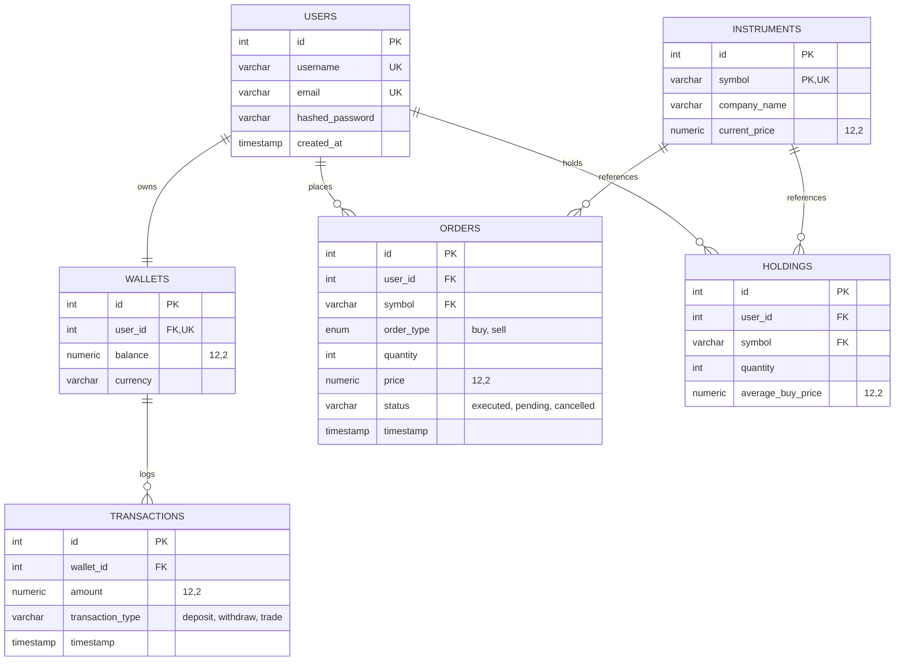

# StockSim Relational Database Schema & Data Contract

This document outlines the database design in **Third Normal Form (3NF)** for StockSim, detailing table structures, relationships, constraints, and data integrity rules.

---

## 1. Entity Relationship Overview

---

## 2. Table Specifications

### `users`
Represents registered platform traders.
- `id` (SERIAL / INT PRIMARY KEY)
- `username` (VARCHAR(50) UNIQUE NOT NULL, INDEXED)
- `email` (VARCHAR(255) UNIQUE NOT NULL, INDEXED)
- `hashed_password` (VARCHAR(255) NOT NULL)
- `created_at` (TIMESTAMPTZ DEFAULT NOW())

### `wallets`
Virtual cash accounts holding available trading capital.
- `id` (SERIAL / INT PRIMARY KEY)
- `user_id` (INT NOT NULL UNIQUE REFERENCES `users(id)` ON DELETE CASCADE, INDEXED)
- `balance` (NUMERIC(12, 2) NOT NULL DEFAULT 10000.00)
- `currency` (VARCHAR(10) NOT NULL DEFAULT 'USD')

### `instruments`
Catalog of tradeable stock instruments and real-time market quotes.
- `id` (SERIAL / INT PRIMARY KEY)
- `symbol` (VARCHAR(10) UNIQUE NOT NULL, INDEXED)
- `company_name` (VARCHAR(200) NOT NULL)
- `current_price` (NUMERIC(12, 2) NOT NULL)

### `orders`
Log of buy and sell market orders submitted by users.
- `id` (SERIAL / INT PRIMARY KEY)
- `user_id` (INT NOT NULL REFERENCES `users(id)` ON DELETE CASCADE, INDEXED)
- `symbol` (VARCHAR(10) NOT NULL REFERENCES `instruments(symbol)`, INDEXED)
- `order_type` (ENUM('buy', 'sell') NOT NULL)
- `quantity` (INT NOT NULL CHECK (quantity > 0))
- `price` (NUMERIC(12, 2) NOT NULL)
- `status` (VARCHAR(20) NOT NULL DEFAULT 'executed')
- `timestamp` (TIMESTAMPTZ DEFAULT NOW())

### `holdings`
User stock positions currently open in their portfolio.
- `id` (SERIAL / INT PRIMARY KEY)
- `user_id` (INT NOT NULL REFERENCES `users(id)` ON DELETE CASCADE, INDEXED)
- `symbol` (VARCHAR(10) NOT NULL REFERENCES `instruments(symbol)`, INDEXED)
- `quantity` (INT NOT NULL CHECK (quantity >= 0))
- `average_buy_price` (NUMERIC(12, 2) NOT NULL)
- **Constraint**: `UNIQUE (user_id, symbol)` ensures each user has at most one holding row per ticker.

### `transactions`
Auditable double-entry transaction log for all wallet activities.
- `id` (SERIAL / INT PRIMARY KEY)
- `wallet_id` (INT NOT NULL REFERENCES `wallets(id)` ON DELETE CASCADE, INDEXED)
- `amount` (NUMERIC(12, 2) NOT NULL CHECK (amount > 0))
- `transaction_type` (VARCHAR(20) NOT NULL) — values: `'deposit'`, `'withdraw'`, `'trade'`
- `timestamp` (TIMESTAMPTZ DEFAULT NOW())

---

## 3. Financial Consistency & ACID Invariants

1. **Atomic Trade Execution**: When a `BUY` order is processed:
   - `wallets.balance` is decremented by `quantity * price`.
   - A `transactions` record is created.
   - `holdings` row is upserted with weighted average price:
     $$\text{New Avg} = \frac{(\text{Old Qty} \times \text{Old Avg}) + (\text{Bought Qty} \times \text{Price})}{\text{Old Qty} + \text{Bought Qty}}$$
   - `orders` row is created.
   - All steps commit atomically.

2. **Negative Balance Guard**: A user cannot buy stock or withdraw cash beyond their `wallets.balance`.
3. **Oversell Guard**: A user cannot sell more shares than currently recorded in `holdings.quantity`.
